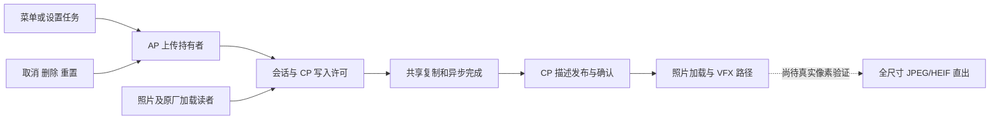

# 架构与源码地图

以下文件均位于 `custom-lut-research/route-a/offline-v0.5/`。最新组合使用 `events` 系列；`upload` 系列是其上一阶段和构建依赖。不要从数量众多的历史验证脚本猜测当前主入口。

| 阅读顺序 | 源码 | 作用／边界 |
|---|---|---|
| 1 | `lut_handoff_ap.c/.h`、`lut_handoff_cp.c/.h` | 事务状态、版本、读者令牌、确认与取消；可先跑主机测试 |
| 2 | `lut_events_owner.c/.h` | 原厂上传任务、常驻请求、超时和原厂取消／删除／重置后端 |
| 3 | `lut_all_readers.h`、`lut_events_native_snapshot.h` | 集中入口持有、缓存完整校验、原厂内部重应用限制 |
| 4 | `lut_reader_worker.c`、`lut_dma_worker.c`、`lut_dma_capture.c` | 入队子令牌、原厂工作线程、DMA 结果与故障隔离 |
| 5 | `photo_lut_reusable.c`、`photo_lut_completion.c`、`lut_photo_snapshot.h` | 照片入口、VFX 回调与本地生命周期；不单独拥有整块共享 LUT |
| 6 | `build_lut_events_owner.py`、`build_lut_events_cp.py` | AP 文件插入、BSS、CP 代码／参数放置和重定位 |
| 7 | `build_lut_events_candidate.py` | 完整候选组合、证据绑定、菜单回归与精确逆修改 |

## 关键原厂接点

AP：上传执行 `0x34289a8`，共享复制 `0x30210c8`，跨芯片调用 `0x3021210`，提交发送 `0x3537f40`，后续设置 `0x342896c`，取消虚表项 `0x5b3db40`，LUT/CUBE 删除 `0x3021338`／`0x302138c`，重置 `0x34c4a88`。

CP：缓存加载入口 `0x4e876c`；普通／附加参数加载 `0x54e15c`／`0x54e398`；数据消息构造 `0xb799de`／`0xb79ab4`；描述发布 `0x35c54c`；内部重新应用分派 `0x35ced4`。它们仅属于已记录的精确程序指纹，不能推广到其他型号或版本。

原厂 LUT 数据覆盖要求为 48,000 字节，附加参数为 124 字节。协议仅在读者排空后允许共享写入。父令牌返回不释放已经入队的子令牌；缺失完成和故障保留隔离。重复发布与普通取消确认不能混同。

## 最重要的验证入口

- `verify_lut_events_integration.py`：真实 AP 任务／队列到冷启动 CP 的离线闭环与故障。
- `verify_lut_menu_events.py`：原厂取消虚调用、删除／重置、装载偏移和超时收尾。
- `verify_lut_events_readers.py`：集中入口、原厂外部调用者、坏描述和写入时序插入。
- `verify_lut_events_photo.py`：当前 CP 组合上的照片回归。
- `verify_menu.py`：指定完整 AP 上的菜单组件检查，由候选构建器调用。

`native/` 和 `install_transaction.py` 保留旧安装事务研究供审阅；它们没有相机适配器，不是本版安装入口。
